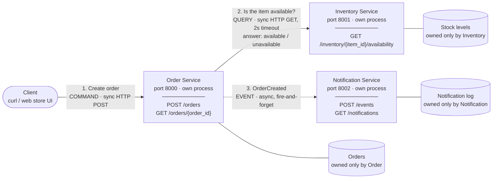
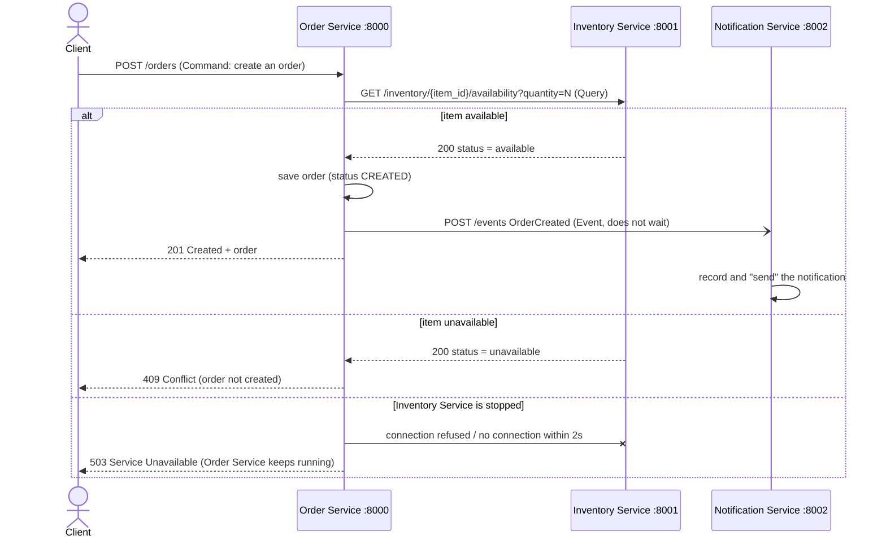

# Online Store: Architecture & Service Boundaries

Module 4 assignment. For this assignment I designed a small online store as three services and implemented the **Order Service → Inventory Service** interaction in Python (Flask).

- **Order Service** creates and tracks orders.
- **Inventory Service** tracks item availability.
- **Notification Service** represents notifying users when an order is created.

Each service is a separate process with its own port and its own in-memory data. When an order is submitted, the Order Service asks the Inventory Service whether the item is available. It creates the order only if the answer is `available`.

The required implementation is Order → Inventory. I also added a small Notification Service so the **Event** (`OrderCreated`) is real and not only on the diagram. Sending is simulated: the notification is logged and stored, and no email goes out.

## Requirement checklist

| README requirement | Where it is |
|---|---|
| Instructions for installing dependencies and running the services | [1. How to install and run](#1-how-to-install-and-run) |
| Architecture diagram | [2. Architecture diagram](#2-architecture-diagram) |
| Responsibility of each component | [3. Component responsibilities](#3-component-responsibilities) |
| Data ownership for each component | [4. Data ownership](#4-data-ownership) |
| Why I chose these service boundaries | [5. Why I chose these service boundaries](#5-why-i-chose-these-service-boundaries) |
| Command / Query / Event classifications | [6. Command, Query, and Event](#6-command-query-and-event) |
| Example of a successful request | [8. Example of a successful request](#8-example-of-a-successful-request) |
| Proof of the Inventory Service failure test | [10. Failure test: Inventory Service stopped](#10-failure-test-inventory-service-stopped) |
| curl / terminal output showing it working | Sections [8](#8-example-of-a-successful-request), [9](#9-unavailable-item-and-other-rejected-orders) and [10](#10-failure-test-inventory-service-stopped), plus the raw files in [`evidence/`](evidence/) |
| 3–5 sentence reflection | [11. Reflection](#11-reflection) |

## What's in the repo

```
inventory_service/app.py       Inventory Service  (port 8001), owns the stock levels
order_service/app.py           Order Service      (port 8000), owns the orders, calls Inventory
notification_service/app.py    Notification Service (port 8002), receives OrderCreated events
scripts/demo.sh                runs the whole demo and saves the output to evidence/
evidence/                      curl output and service logs used in this README
requirements.txt               Flask 3.1.3, requests 2.34.2
```

Sample inventory data, kept in memory by the Inventory Service (no database):

| item_id | laptop | monitor | mouse | keyboard |
|---|---|---|---|---|
| units in stock | 10 | 3 | 25 | 0 |

---

## 1. How to install and run

I used Python 3.13 on Windows 11. Any Python 3.10+ should work, on Windows, macOS or Linux. You also need `curl`, which ships with Windows 10/11, macOS and Git Bash.

### Install dependencies

```bash
git clone https://github.com/juileegiramkar/Architecture_Service_Boundaries.git
cd Architecture_Service_Boundaries
python -m venv .venv
source .venv/bin/activate        # Git Bash on Windows: source .venv/Scripts/activate
pip install -r requirements.txt
```

In Windows PowerShell, activate with `.venv\Scripts\Activate.ps1` instead. If that's blocked, run `Set-ExecutionPolicy -Scope Process Bypass` first.

### Run the services (each in its own terminal)

Every service is a separate process, so open **three terminals**. In each one, `cd` into the repo folder and activate the venv, then start one service:

```bash
# Terminal 1 - Inventory Service on http://127.0.0.1:8001
python inventory_service/app.py
```

```bash
# Terminal 2 - Notification Service on http://127.0.0.1:8002 (optional, for the OrderCreated event)
python notification_service/app.py
```

```bash
# Terminal 3 - Order Service on http://127.0.0.1:8000
python order_service/app.py
```

| Service | Port | Start command | Options |
|---|---|---|---|
| Inventory | 8001 | `python inventory_service/app.py` | `--port` |
| Notification | 8002 | `python notification_service/app.py` | `--port` |
| Order | 8000 | `python order_service/app.py` | `--port`, `--inventory-url` (default `http://127.0.0.1:8001`), `--notification-url` (default `http://127.0.0.1:8002`, `""` turns events off), `--timeout` (seconds to wait for Inventory, default 2) |

The services can start in any order. If the Order Service starts before Inventory, orders return 503 until Inventory is up.

### Send requests

From a fourth terminal (bash / Git Bash / macOS / Linux):

```bash
# Query Inventory directly
curl -s "http://127.0.0.1:8001/inventory/laptop/availability?quantity=2"

# Submit an order (available item -> 201 Created)
curl -s -i -X POST http://127.0.0.1:8000/orders -H "Content-Type: application/json" -d '{"customer_id": "c-101", "item_id": "laptop", "quantity": 2}'

# Submit an order for an out-of-stock item (-> 409 Conflict)
curl -s -i -X POST http://127.0.0.1:8000/orders -H "Content-Type: application/json" -d '{"customer_id": "c-101", "item_id": "keyboard", "quantity": 1}'

# Track orders, check health, see notifications
curl -s http://127.0.0.1:8000/orders/ORD-0001
curl -s http://127.0.0.1:8000/health
curl -s http://127.0.0.1:8002/notifications
```

In Windows PowerShell, type `curl.exe` (plain `curl` is an alias for `Invoke-WebRequest`) and escape the quotes inside the JSON:

```powershell
curl.exe -s -i -X POST http://127.0.0.1:8000/orders -H "Content-Type: application/json" -d '{\"customer_id\": \"c-101\", \"item_id\": \"laptop\", \"quantity\": 2}'
```

### Run the failure test yourself

1. Press **Ctrl+C** in Terminal 1 to stop the Inventory Service.
2. Submit another order with the `curl` command above. You get `503 Service Unavailable`.
3. Run `curl -s http://127.0.0.1:8000/health`. The Order Service is still `up`, with the same `pid`.
4. Start Inventory again (`python inventory_service/app.py`) and re-send the order. It's created again without restarting the Order Service.

### Or run everything with one script

`scripts/demo.sh` starts all three services, sends every request shown in this README (including the failure test), and saves the output to `evidence/`:

```bash
bash scripts/demo.sh
```

Run it in Git Bash on Windows, or in bash on macOS/Linux. The venv from above must exist. Rerunning it overwrites `evidence/`, so the pids and timestamps there will differ from the ones quoted below.

---

## 2. Architecture diagram



- **Solid arrows** are synchronous request/response over HTTP. The caller waits for the answer.
- **The dotted arrow** is an asynchronous event. The Order Service publishes it and does not wait for a reply.
- Each service owns its own data store (the cylinders), and only that service touches it. No service reads another service's data directly. It has to go through that service's API, or receive an event.

The same flow as a sequence, with the three possible outcomes of the Inventory check:



---

## 3. Component responsibilities

| Component | Responsibility | Endpoints |
|---|---|---|
| **Order Service** (port 8000) | Accepts order requests and validates them (customer, item, quantity). Asks Inventory whether the item is available, then creates the order or rejects it. Tracks orders (`order_id`, status, time) so clients can look them up later. After an order is created, it publishes an `OrderCreated` event. It handles Inventory failures and returns a clear error instead of crashing. | `POST /orders`, `GET /orders`, `GET /orders/{order_id}`, `GET /health` |
| **Inventory Service** (port 8001) | The single source of truth for item availability. It answers "is item X available in quantity N?" with `available` or `unavailable`, and `404` if it doesn't know the item. It doesn't know anything about orders or customers. | `GET /inventory/{item_id}/availability?quantity=N`, `GET /inventory`, `GET /health` |
| **Notification Service** (port 8002) | Notifies users when something happens to their order. It listens for `OrderCreated` events and "sends" a message to the customer (simulated as email and stored in a log). It never blocks or fails an order. | `POST /events`, `GET /notifications`, `GET /health` |
| **Client** (curl here, a web store UI in real life) | Sends commands and queries to the Order Service. It only talks to the Order Service for orders and never calls Inventory or Notification itself. | none |

---

## 4. Data ownership

Each service is the **only** writer and the source of truth for its own data. There is no shared database. In this project each service keeps its data in memory, in its own process, so the separation is enforced: no other process can reach that memory.

| Service | Data it owns (source of truth) | Data it does **not** own | How it gets other data it needs |
|---|---|---|---|
| **Order** | Orders: `order_id`, `customer_id`, `item_id`, `quantity`, `status`, `created_at`, plus the order-id counter | Stock levels, notification history | Asks Inventory through the availability **Query** when an order comes in. It stores `item_id` only as a reference and never keeps its own copy of the stock count. |
| **Inventory** | The item catalog and stock levels (`item_id` → units in stock) | Orders, customers, notifications | Nothing. It doesn't call other services. |
| **Notification** | The notification log (who was notified, about which order, when, on which channel) and the ids of events it already handled, so a duplicate event isn't sent twice. In a real system it would also own contact preferences and message templates. | Orders, stock levels | Gets what it needs from the **Event** payload (`order_id`, `customer_id`, `item_id`, `quantity`), so it never calls back into the Order Service. |

What this rules out:

- The Order Service never reads or changes the stock dictionary. Only Inventory can decide whether something is available.
- The Inventory Service has no idea an order exists.
- The Notification Service doesn't query the Order Service's data. The event already carries what it needs.

---

## 5. Why I chose these service boundaries

1. **One business capability per service.** Taking orders, managing stock, and talking to customers are different jobs. They change for different reasons: order rules and statuses, stock and warehouse rules, and email/SMS channels and templates. Splitting along those lines means a change to one usually touches only one service.
2. **Data that changes together lives together.** An order's fields and its status are always updated together, so they're in one service. Stock levels are only updated by stock operations, so they're in Inventory. No piece of data is split across two services, which would mean keeping two copies in sync.
3. **Loose coupling through small contracts.** The Order Service only knows one Inventory endpoint and its JSON answer, not how stock is stored. The Notification Service only knows the shape of the `OrderCreated` event. Each side can change its internals without breaking the others, as long as the contract stays the same.
4. **The communication style matches the need.** The Order Service *needs* Inventory's answer before it can create an order, so that call is a synchronous **Query** with a timeout. Notifying the customer is a side effect that shouldn't slow down or fail an order, so it's an asynchronous **Event**. If notification code lived inside the Order Service, an email outage could break checkout.
5. **Failure isolation and independent scaling.** Each service is its own process, so one can crash or be redeployed without taking the others down (the failure test below shows this). They can also scale differently. Inventory gets a read on every order, so it can be scaled or cached on its own. Notification can lag behind or retry without anyone noticing.
6. **Not too fine-grained.** I didn't split, for example, "create order" and "track order" into separate services. They use exactly the same data, so splitting them would force the two to share a database or constantly sync. Three services is enough to show clear ownership without adding network calls that don't buy anything.

---

## 6. Command, Query, and Event

| Interaction | Type | Why | In this implementation |
|---|---|---|---|
| **Check whether an item is available** | **Query** | It only *asks for information* and returns an answer (`available` / `unavailable`). It doesn't change any state, so it's safe to repeat any number of times and always gives the same answer for the same stock. | `GET /inventory/{item_id}/availability?quantity=N` on the Inventory Service → `200 {"status": "available" \| "unavailable"}` |
| **Create an order** | **Command** | It's a *request to change state*, phrased as an instruction ("create"). It's sent to the one service that owns orders, and that service can accept or reject it: `201` created, or `409` unavailable / `404` unknown item / `503` dependency down. Sending it twice creates two orders, so it isn't a harmless read. | `POST /orders` on the Order Service |
| **Order was created** | **Event** | It's a *fact about something that already happened*, named in the past tense. Nobody can reject it, because the order already exists. The publisher doesn't expect a reply and doesn't care who listens: Notification today, maybe Shipping or Analytics later, with no change to the Order Service's logic. | `OrderCreated`, published by the Order Service after a successful order, asynchronously to `POST /events` on the Notification Service |

In short, a **Command** says "please do this" (it can fail), a **Query** says "tell me this" (no side effects), and an **Event** says "this happened" (no reply expected).

---

## 7. API reference

**Order Service: `POST /orders`**, body `{"customer_id": "c-101", "item_id": "laptop", "quantity": 2}`

| Result | Status | When |
|---|---|---|
| Order created | `201 Created` (+ `Location: /orders/ORD-000N`) | Inventory said `available` |
| Bad input | `400 Bad Request` | Body isn't JSON, a field is missing, or quantity < 1. Inventory isn't called. |
| Unknown item | `404 Not Found` | Inventory doesn't know the `item_id` |
| Not available | `409 Conflict` | Inventory said `unavailable`. The order is not created. |
| Inventory sent something unexpected | `502 Bad Gateway` | Inventory answered, but not with a valid availability response |
| **Inventory is down** | **`503 Service Unavailable`** (+ `Retry-After: 10`) | Could not connect to Inventory (stopped, or connection refused) |
| Inventory too slow | `504 Gateway Timeout` | Connected, but no answer within `--timeout` (2s) |

Other endpoints: `GET /orders`, `GET /orders/{order_id}` (404 if unknown), and `GET /health` (status, pid, uptime and counters) on the Order Service. `GET /inventory/{item_id}/availability?quantity=N`, `GET /inventory` and `GET /health` on the Inventory Service. `POST /events` (returns `202 Accepted`), `GET /notifications` and `GET /health` on the Notification Service.

---

## 8. Example of a successful request

All output in sections 8–10 is copied unchanged from the files in [`evidence/`](evidence/), produced by `bash scripts/demo.sh` on 2026-10-19 on Windows 11. Log times are local time (PDT). JSON timestamps and the HTTP `Date` header are UTC.

**The three services running as independent processes.** Each has its own pid and port ([`evidence/01_services_running.txt`](evidence/01_services_running.txt)):

```
# Each service is its own OS process with its own pid and port
$ curl -s http://127.0.0.1:8001/health
{
  "service": "inventory-service",
  "status": "up",
  "pid": 28128,
  "uptime_seconds": 0.6
}


$ curl -s http://127.0.0.1:8000/health
{
  "service": "order-service",
  "status": "up",
  "pid": 26788,
  "uptime_seconds": 0.7,
  "orders_created": 0,
  "orders_rejected": 0,
  "inventory_failures": 0
}


$ curl -s http://127.0.0.1:8002/health
{
  "service": "notification-service",
  "status": "up",
  "pid": 7496,
  "uptime_seconds": 1.0
}
```

**The Query on its own.** Asking Inventory directly whether an item is available ([`evidence/02_inventory_query.txt`](evidence/02_inventory_query.txt)):

```
$ curl -s -i "http://127.0.0.1:8001/inventory/laptop/availability?quantity=2"
HTTP/1.1 200 OK
Server: Werkzeug/3.1.9 Python/3.13.15
Date: Mon, 19 Oct 2026 21:20:01 GMT
Content-Type: application/json
Content-Length: 96
Connection: close

{
  "item_id": "laptop",
  "requested_quantity": 2,
  "in_stock": 10,
  "status": "available"
}


$ curl -s -i "http://127.0.0.1:8001/inventory/keyboard/availability?quantity=1"
HTTP/1.1 200 OK
Server: Werkzeug/3.1.9 Python/3.13.15
Date: Mon, 19 Oct 2026 21:20:01 GMT
Content-Type: application/json
Content-Length: 99
Connection: close

{
  "item_id": "keyboard",
  "requested_quantity": 1,
  "in_stock": 0,
  "status": "unavailable"
}
```

**A successful order.** The Order Service asks Inventory, gets `available`, creates `ORD-0001`, and publishes `OrderCreated`. The Notification Service then notifies the customer ([`evidence/03_successful_order.txt`](evidence/03_successful_order.txt)):

```
$ curl -s -i -X POST http://127.0.0.1:8000/orders -H "Content-Type: application/json" -d '{"customer_id": "c-101", "item_id": "laptop", "quantity": 2}'
HTTP/1.1 201 CREATED
Server: Werkzeug/3.1.9 Python/3.13.15
Date: Mon, 19 Oct 2026 21:20:01 GMT
Content-Type: application/json
Content-Length: 290
Location: /orders/ORD-0001
Connection: close

{
  "message": "Order created",
  "order": {
    "order_id": "ORD-0001",
    "customer_id": "c-101",
    "item_id": "laptop",
    "quantity": 2,
    "status": "CREATED",
    "created_at": "2026-10-19T21:20:01+00:00"
  },
  "inventory": {
    "status": "available",
    "in_stock": 10
  }
}


# Track the order that was just created
$ curl -s http://127.0.0.1:8000/orders/ORD-0001
{
  "order_id": "ORD-0001",
  "customer_id": "c-101",
  "item_id": "laptop",
  "quantity": 2,
  "status": "CREATED",
  "created_at": "2026-10-19T21:20:01+00:00"
}


# Event: Notification Service received OrderCreated and notified the customer
$ curl -s http://127.0.0.1:8002/notifications
{
  "notifications": [
    {
      "notification_id": "NTF-0001",
      "customer_id": "c-101",
      "order_id": "ORD-0001",
      "channel": "email (simulated)",
      "message": "Your order ORD-0001 for 2 x laptop has been created.",
      "sent_at": "2026-10-19T21:20:01+00:00"
    }
  ]
}
```

---

## 9. Unavailable item and other rejected orders

When Inventory answers `unavailable`, the Order Service returns `409 Conflict` and doesn't create the order. Unknown items get `404`, and bad input gets `400` before Inventory is even called ([`evidence/04_rejected_orders.txt`](evidence/04_rejected_orders.txt)):

```
# keyboard has 0 units in stock -> Inventory says unavailable -> 409
$ curl -s -i -X POST http://127.0.0.1:8000/orders -H "Content-Type: application/json" -d '{"customer_id": "c-101", "item_id": "keyboard", "quantity": 1}'
HTTP/1.1 409 CONFLICT
Server: Werkzeug/3.1.9 Python/3.13.15
Date: Mon, 19 Oct 2026 21:20:03 GMT
Content-Type: application/json
Content-Length: 189
Connection: close

{
  "error": "ITEM_UNAVAILABLE",
  "message": "Order not created: only 0 unit(s) of 'keyboard' in stock, 1 requested",
  "inventory": {
    "status": "unavailable",
    "in_stock": 0
  }
}


# monitor has 3 units, 5 requested -> unavailable -> 409
$ curl -s -i -X POST http://127.0.0.1:8000/orders -H "Content-Type: application/json" -d '{"customer_id": "c-101", "item_id": "monitor", "quantity": 5}'
HTTP/1.1 409 CONFLICT
Server: Werkzeug/3.1.9 Python/3.13.15
Date: Mon, 19 Oct 2026 21:20:04 GMT
Content-Type: application/json
Content-Length: 188
Connection: close

{
  "error": "ITEM_UNAVAILABLE",
  "message": "Order not created: only 3 unit(s) of 'monitor' in stock, 5 requested",
  "inventory": {
    "status": "unavailable",
    "in_stock": 3
  }
}


# item that does not exist -> 404
$ curl -s -i -X POST http://127.0.0.1:8000/orders -H "Content-Type: application/json" -d '{"customer_id": "c-101", "item_id": "tablet", "quantity": 1}'
HTTP/1.1 404 NOT FOUND
Server: Werkzeug/3.1.9 Python/3.13.15
Date: Mon, 19 Oct 2026 21:20:04 GMT
Content-Type: application/json
Content-Length: 96
Connection: close

{
  "error": "ITEM_NOT_FOUND",
  "message": "Order not created: item 'tablet' does not exist"
}


# invalid quantity -> 400 (rejected before calling Inventory)
$ curl -s -i -X POST http://127.0.0.1:8000/orders -H "Content-Type: application/json" -d '{"customer_id": "c-101", "item_id": "laptop", "quantity": 0}'
HTTP/1.1 400 BAD REQUEST
Server: Werkzeug/3.1.9 Python/3.13.15
Date: Mon, 19 Oct 2026 21:20:04 GMT
Content-Type: application/json
Content-Length: 82
Connection: close

{
  "error": "INVALID_REQUEST",
  "message": "quantity must be an integer >= 1"
}
```

---

## 10. Failure test: Inventory Service stopped

**Test:** with all services running, stop the Inventory Service and submit another order.

**Expected:** the Order Service handles the dependency failure, returns an appropriate error, and stays running.

**Result:** the order gets **`503 Service Unavailable`**, with a JSON error saying the order was not created and a `Retry-After` header. The Order Service keeps running. Its `/health` still says `up` with the **same pid (26788)** before and after, and it still serves the order it created earlier. Once Inventory is restarted, the same Order Service process creates orders again.

Full output ([`evidence/05_failure_test.txt`](evidence/05_failure_test.txt)):

```
# Order Service before the failure (note the pid)
$ curl -s http://127.0.0.1:8000/health
{
  "service": "order-service",
  "status": "up",
  "pid": 26788,
  "uptime_seconds": 4.8,
  "orders_created": 1,
  "orders_rejected": 3,
  "inventory_failures": 0
}


# Inventory Service stopped. Nothing is listening on port 8001 any more:
$ curl -sS http://127.0.0.1:8001/health; echo "curl exit code: $?"
curl: (7) Failed to connect to 127.0.0.1 port 8001 after 2040 ms: Could not connect to server
curl exit code: 7


# Submit another order while Inventory is down
$ curl -s -i -w '\ntime_total=%{time_total}s\n' -X POST http://127.0.0.1:8000/orders -H "Content-Type: application/json" -d '{"customer_id": "c-101", "item_id": "laptop", "quantity": 1}'
HTTP/1.1 503 SERVICE UNAVAILABLE
Server: Werkzeug/3.1.9 Python/3.13.15
Date: Mon, 19 Oct 2026 21:20:11 GMT
Content-Type: application/json
Content-Length: 187
Retry-After: 10
Connection: close

{
  "error": "INVENTORY_SERVICE_UNAVAILABLE",
  "message": "Order not created: the Inventory Service is unavailable, so item availability could not be checked. Please try again later."
}

time_total=2.038546s


# Order Service is still running: same pid, status up, inventory_failures counted
$ curl -s http://127.0.0.1:8000/health
{
  "service": "order-service",
  "status": "up",
  "pid": 26788,
  "uptime_seconds": 12.0,
  "orders_created": 1,
  "orders_rejected": 3,
  "inventory_failures": 1
}


# and it still serves its own data (the order created before the failure)
$ curl -s http://127.0.0.1:8000/orders
{
  "orders": [
    {
      "order_id": "ORD-0001",
      "customer_id": "c-101",
      "item_id": "laptop",
      "quantity": 2,
      "status": "CREATED",
      "created_at": "2026-10-19T21:20:01+00:00"
    }
  ]
}
```

**Order Service terminal output** for the whole run ([`evidence/order_service.log`](evidence/order_service.log)). The failed order is logged as a single `WARNING` line, with no traceback and no crash. The next order at 14:20:13 is handled by the same process:

```
14:20:00 INFO    order-service | Order Service on http://127.0.0.1:8000 (pid 26788) inventory=http://127.0.0.1:8001 notification=http://127.0.0.1:8002 timeout=2.0s
 * Serving Flask app 'app'
 * Debug mode: off
14:20:01 INFO    order-service | POST /orders customer_id=c-101 item_id=laptop quantity=2
14:20:01 INFO    order-service | Inventory: laptop available (in_stock=10) -> 201, created ORD-0001
14:20:01 INFO    order-service | published OrderCreated event for ORD-0001
14:20:03 INFO    order-service | POST /orders customer_id=c-101 item_id=keyboard quantity=1
14:20:03 INFO    order-service | Inventory: keyboard unavailable (in_stock=0, requested=1) -> 409, order not created
14:20:04 INFO    order-service | POST /orders customer_id=c-101 item_id=monitor quantity=5
14:20:04 INFO    order-service | Inventory: monitor unavailable (in_stock=3, requested=5) -> 409, order not created
14:20:04 INFO    order-service | POST /orders customer_id=c-101 item_id=tablet quantity=1
14:20:04 INFO    order-service | Inventory: item tablet not found -> 404
14:20:09 INFO    order-service | POST /orders customer_id=c-101 item_id=laptop quantity=1
14:20:11 WARNING order-service | Inventory Service unreachable at http://127.0.0.1:8001 (ConnectTimeout) -> 503, order not created
14:20:13 INFO    order-service | POST /orders customer_id=c-101 item_id=laptop quantity=1
14:20:13 INFO    order-service | Inventory: laptop available (in_stock=10) -> 201, created ORD-0002
14:20:13 INFO    order-service | published OrderCreated event for ORD-0002
```

**Recovery after restarting Inventory.** Same Order Service pid, with no restart needed ([`evidence/06_recovery.txt`](evidence/06_recovery.txt)):

```
$ curl -s -i -X POST http://127.0.0.1:8000/orders -H "Content-Type: application/json" -d '{"customer_id": "c-101", "item_id": "laptop", "quantity": 1}'
HTTP/1.1 201 CREATED
Server: Werkzeug/3.1.9 Python/3.13.15
Date: Mon, 19 Oct 2026 21:20:13 GMT
Content-Type: application/json
Content-Length: 290
Location: /orders/ORD-0002
Connection: close

{
  "message": "Order created",
  "order": {
    "order_id": "ORD-0002",
    "customer_id": "c-101",
    "item_id": "laptop",
    "quantity": 1,
    "status": "CREATED",
    "created_at": "2026-10-19T21:20:13+00:00"
  },
  "inventory": {
    "status": "available",
    "in_stock": 10
  }
}


$ curl -s http://127.0.0.1:8000/health
{
  "service": "order-service",
  "status": "up",
  "pid": 26788,
  "uptime_seconds": 13.4,
  "orders_created": 2,
  "orders_rejected": 3,
  "inventory_failures": 1
}
```

**How the code handles it** (condensed from [`order_service/app.py`](order_service/app.py)). Every call to Inventory has a timeout and is wrapped in `try/except`. A network failure becomes an HTTP error response for that one request, and nothing propagates up to crash the process:

```python
try:
    reply = requests.get(url, params={"quantity": quantity}, timeout=timeout_seconds)
except requests.exceptions.ReadTimeout:
    # Connected, but no answer in time -> 504 Gateway Timeout
    ...
except requests.exceptions.RequestException as exc:
    # Could not connect at all (Inventory stopped / connection refused) -> 503 Service Unavailable
    ...
```

Why the failed request took about 2 seconds: on Windows, a connection to a closed port on `localhost` isn't refused immediately. Windows retries for about 2 seconds first, and you can see the same 2040 ms in the plain `curl` to port 8001 above. With the 2s timeout, `requests` reports this as `ConnectTimeout`, which is why the log says `(ConnectTimeout)`. On macOS/Linux the refusal is immediate and shows up as `ConnectionError`. Both mean "could not reach Inventory", so both map to **503**. **504** is kept for the different case where Inventory accepts the connection but is too slow to answer.

---

## 11. Reflection

Clear service boundaries let each part of the system be built, deployed, and scaled on its own, because other services depend only on its small API and not on its internals. Data ownership is what makes those boundaries real: since only the Inventory Service owns stock levels, there is exactly one place that decides whether an item is available, and the Order Service has to ask through a contract instead of reading or overwriting another service's data. Without that ownership, services end up sharing tables, so a schema change or a bad write in one service silently breaks the others and nobody knows which copy of the data is correct. Clear boundaries also limit the blast radius of failures, which I saw in my failure test: stopping the Inventory Service only blocked new orders with a clear 503, while the Order Service kept running and the Notification Service was unaffected.

---

## 12. Limitations and what I would do in production

- **In-memory data.** Orders, stock and notifications reset when a service restarts. In production, each service would get its **own** database: still one owner per data set, never a shared database.
- **The availability check doesn't reserve stock.** Two orders could both see `available` for the last unit. A real system would turn the check into a "reserve stock" command, or have Inventory consume `OrderCreated` to decrement stock, with a compensating action if that fails.
- **Event delivery is best-effort.** `OrderCreated` is sent with a plain HTTP POST in a background thread, and it's lost if the Notification Service is down. The order itself is still created, which is the point. In production I'd use a message broker (RabbitMQ, Kafka, SQS) plus the outbox pattern, so events are stored and retried. The Notification Service already ignores duplicate `event_id`s, which retries would need.
- **No retries or circuit breaker** on the Inventory call. A circuit breaker would stop waiting the full 2 seconds on every order while Inventory is known to be down.
